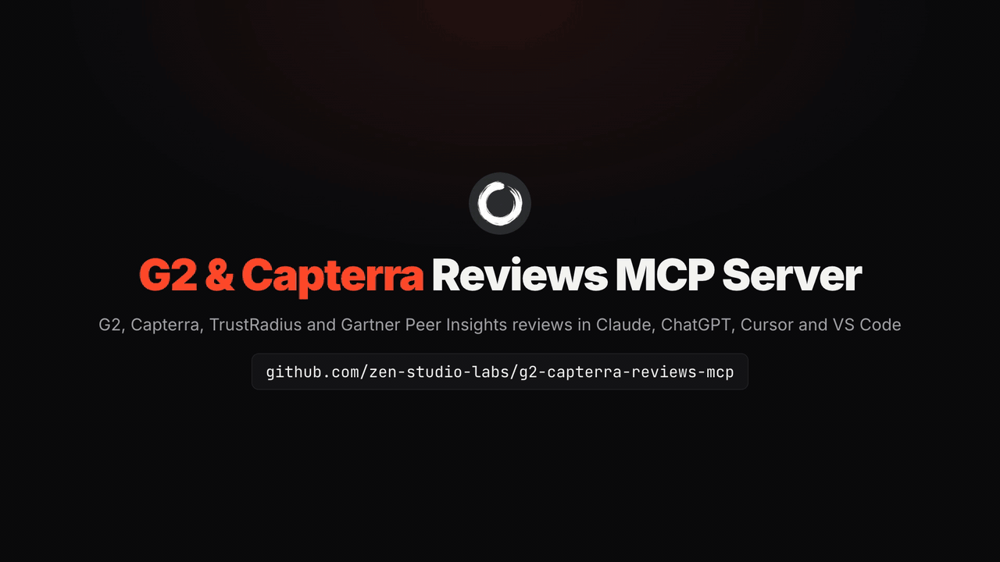
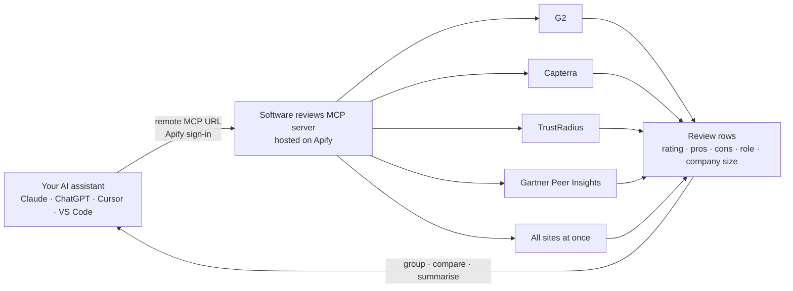

<div align="center">


# G2 & Capterra Reviews MCP Server

**G2, Capterra, TrustRadius and Gartner Peer Insights reviews inside Claude, ChatGPT, Cursor and your own code: read what customers praise and dislike, compare products, filter by rating, date and company size. Hosted and read-only. No G2 or Capterra login, no API keys, nothing to install.**

[](https://apify.com/zen-studio/g2-reviews-scraper)
[](https://github.com/zen-studio-labs/g2-capterra-reviews-mcp/actions/workflows/validate.yml)
[](LICENSE)



<sub>Built from a real G2 reviews run on 2 November 2026.</sub>

[](https://cursor.com/en/install-mcp?name=software-reviews&config=eyJ1cmwiOiJodHRwczovL21jcC5hcGlmeS5jb20vP3Rvb2xzPWZldGNoLWFjdG9yLWRldGFpbHMsZ2V0LWFjdG9yLXJ1bixnZXQtZGF0YXNldC1pdGVtcyx6ZW4tc3R1ZGlvL3NvZnR3YXJlLXJldmlldy1zY3JhcGVyLHplbi1zdHVkaW8vZzItcmV2aWV3cy1zY3JhcGVyLHplbi1zdHVkaW8vY2FwdGVycmEtcmV2aWV3cy1zY3JhcGVyLHplbi1zdHVkaW8vdHJ1c3RyYWRpdXMtcmV2aWV3LXNjcmFwZXIsemVuLXN0dWRpby9nYXJ0bmVyLXJldmlldy1zY3JhcGVyIn0=)
[](https://vscode.dev/redirect/mcp/install?name=software-reviews&config=%7B%22type%22%3A%22http%22%2C%22url%22%3A%22https%3A%2F%2Fmcp.apify.com%2F%3Ftools%3Dfetch-actor-details%2Cget-actor-run%2Cget-dataset-items%2Czen-studio%2Fsoftware-review-scraper%2Czen-studio%2Fg2-reviews-scraper%2Czen-studio%2Fcapterra-reviews-scraper%2Czen-studio%2Ftrustradius-review-scraper%2Czen-studio%2Fgartner-review-scraper%22%7D)
[](#client-setup)

[Quick start](#quick-start) · [Agent setup](#set-up-with-your-ai-agent) · [Tools](#tools) · [Prompts](#example-prompts) · [Client setup](#client-setup) · [API](#use-it-as-a-g2--capterra-reviews-api) · [Pricing](#pricing) · [FAQ](#faq)

</div>

G2 & Capterra Reviews MCP is a hosted software reviews MCP server that connects your AI assistant to G2 (formerly G2 Crowd), Capterra, TrustRadius and Gartner Peer Insights. Ask in plain words: your assistant collects the reviews of any business software product, filtered by star rating, date, keyword or company size, and returns ratings, pros and cons, the full review text, the reviewer's job title, industry and company size, and each site's own extras such as sub-ratings, alternatives considered and reasons for switching. Results come back as structured rows it can sort, group, compare and summarise, which is what product marketing, competitive intelligence, sales enablement and voice-of-customer teams need, and what investors use for SaaS due diligence. Developers can call the same tools as a G2 and Capterra reviews API.

## Why G2 & Capterra Reviews MCP

- **No review-site account and no API keys.** No G2, Capterra or Gartner login, no key to request, no monthly request quota to buy, no browser extension.
- **Nothing to install.** Add one URL and sign in with Apify. Works in claude.ai and ChatGPT too, not only in desktop apps.
- **Four review sites in one server.** A tool for each of G2, Capterra, TrustRadius and Gartner Peer Insights with that site's own filters, plus one tool that collects a product's reviews from several sites at once in one shared format, by product name alone.
- **The context behind every rating.** Pros and cons, full text, job title, industry and company size, verified and incentivized flags, Capterra's four sub-ratings and switching reasons, TrustRadius feature ratings and alternatives considered, Gartner markets and revenue bands.
- **Maintained for you.** Used by more than 1,000 people on the Apify Store. When a review site changes, the tools are updated; your setup stays the same.
- **Made for assistants.** A bundled skill teaches your assistant which tool fits which question, the inputs that work and how to read each site's fields, and long requests keep running while it checks back.
- **Pay per review.** Plus a small start fee per run, billed to your own Apify account. No subscription; try it on Apify's free plan.

| | G2 & Capterra Reviews MCP | Typical self-hosted G2 and Capterra tools |
|---|---|---|
| Review-site account, API key or request quota | Not needed | An API key with a monthly quota, or your own login |
| Setup | One URL and an Apify sign-in | Python, Playwright or Selenium, a local Chrome, environment variables |
| Web assistants (claude.ai, ChatGPT) | Supported | Rarely: most are scripts, not MCP servers |
| When a review site changes | Updated for you | Wait for a fix, or fix it yourself |
| Sites | G2, Capterra, TrustRadius and Gartner Peer Insights (Trustpilot on request) | Usually one or two |
| Job title, industry, company size, sub-ratings, alternatives | Included | Varies, often rating and text only |
| Cost | Pay per review | Free software, your own machine and time, or a monthly plan |

## How it works



Each request starts a run on your Apify account. Your assistant waits for it, reads the rows, and answers in plain language. Go deeper in a second request: collect a product's reviews from every site by name, then open the site with the most detail for the lowest-rated reviews, or run the same question on a competitor.

## Quick start

1. **Create a free [Apify account](https://console.apify.com/sign-up)** if you do not have one.
2. **Add the server to your assistant.** Click a button above, or follow the steps for your client below.
3. **Sign in with Apify when your assistant asks**, then ask a question such as *"What do G2 reviewers dislike about HubSpot Sales Hub versus Pipedrive? Use the 15 newest reviews of each and group them by company size."*

**About the Apify sign-in page.** Apify notes that your assistant "was registered dynamically and wasn't verified by Apify" and asks for full API access. Every assistant that signs in this way sees that notice; it lets your assistant start runs on your account. You can remove the access at any time on your [Apify Console integrations page](https://console.apify.com/settings/integrations).

Server URL, for any client that accepts a remote MCP server:

```text
https://mcp.apify.com/?tools=fetch-actor-details,get-actor-run,get-dataset-items,zen-studio/software-review-scraper,zen-studio/g2-reviews-scraper,zen-studio/capterra-reviews-scraper,zen-studio/trustradius-review-scraper,zen-studio/gartner-review-scraper
```

## Set up with your AI agent

Paste this repository's URL into Claude Code, Codex, Cursor or another agent and ask it to set up the G2 and Capterra reviews server. The steps below are written so your agent can follow them.

**For AI agents installing this server:**

1. This is a hosted remote MCP server (streamable HTTP). There is nothing to download or build. It needs a free Apify account and an Apify sign-in (OAuth) in the user's browser; do not ask for an API token unless the sign-in fails.
2. Server name `software-reviews`, server URL:
   ```text
   https://mcp.apify.com/?tools=fetch-actor-details,get-actor-run,get-dataset-items,zen-studio/software-review-scraper,zen-studio/g2-reviews-scraper,zen-studio/capterra-reviews-scraper,zen-studio/trustradius-review-scraper,zen-studio/gartner-review-scraper
   ```
3. Add it with the client's own command:
   - Claude Code: `claude plugin marketplace add zen-studio-labs/g2-capterra-reviews-mcp`, then `claude plugin install software-reviews@g2-capterra-reviews-mcp` (adds the server and the software reviews skill).
   - Codex: `codex mcp add software-reviews --url "<server URL>"`, then `codex mcp login software-reviews`.
   - VS Code: `code --add-mcp '{"name":"software-reviews","type":"http","url":"<server URL>"}'`.
   - Cursor and other clients: add `{"mcpServers": {"software-reviews": {"url": "<server URL>"}}}` to the client's MCP config file (Cursor: `~/.cursor/mcp.json`).
4. Ask the user to complete the sign-in. In Claude Code they run `/mcp`, select software-reviews and choose **Authenticate**; other clients open the Apify sign-in page themselves. A client restart may be needed before the tools appear.
5. Check it works without starting a paid run: call `fetch-actor-details` for `zen-studio/g2-reviews-scraper` and confirm it returns the input reference. The first real request is the user's own; keep it small (for example `"limit": 10` on G2, `"maxResults": 10` on Capterra, TrustRadius or Gartner Peer Insights).
6. Before real requests, read the [software reviews skill](skills/software-reviews/SKILL.md): it explains how long runs work, which tool fits which question and which inputs return good results.

## Tools

| Tool | What you get | Store page |
|---|---|---|
| All sites at once | One product's reviews from G2, Capterra, TrustRadius and Gartner Peer Insights, with Trustpilot on request, in one shared format. Start from a product name, a company domain or any review page link; the product is found on each site. Ratings on a common five-point scale with the original kept, reviewer job title, industry and company size, and each site's extras. Ask for at least 100 reviews per run (`maxResults`); they are shared out by how many reviews each site has. | [software-review-scraper](https://apify.com/zen-studio/software-review-scraper) |
| G2 reviews | Reviews of a G2 product, or of every product a vendor lists on G2. Likes, dislikes, recommendations and problems solved as separate answers, star rating, job title, company size, industry, verified, current-user and incentivized flags. Newest, lowest or highest rated first; filter by stars, by date ("since 1 October") or by words in the review. Also G2's pros and cons summary with mention counts, the star breakdown, and video reviews on request (billed per video, on top of the text reviews). | [g2-reviews-scraper](https://apify.com/zen-studio/g2-reviews-scraper) |
| Capterra reviews | Every review of a product with pros, cons, general comments, overall rating, four sub-ratings (ease of use, customer support, functionality, value for money), likelihood to recommend, why the reviewer chose or switched, the products they compared, job title, industry, company size, time used and the vendor's reply. The product's Capterra profile usually comes with the run. Works with Capterra's country sites. | [capterra-reviews-scraper](https://apify.com/zen-studio/capterra-reviews-scraper) |
| TrustRadius reviews | Reviews with the ten-point rating, pros and cons, use cases, return on investment, feature ratings, alternatives considered and other software used, plus the reviewer's role, department, industry and company size. Filter by stars and by company size (small, mid-size, large). | [trustradius-review-scraper](https://apify.com/zen-studio/trustradius-review-scraper) |
| Gartner Peer Insights reviews | Reviews of up to ten products per run with headline, summary, rating, job title, industry and company size as an annual revenue band, plus each product's profile: average rating, star breakdown, Gartner market, top alternatives, and the most favourable and most critical review in full. | [gartner-review-scraper](https://apify.com/zen-studio/gartner-review-scraper) |

All tools are read-only. They never post reviews, reply to reviewers, vote or contact anyone.

<details>
<summary><b>Key fields per tool</b></summary>

| Tool | Key fields |
|---|---|
| All sites at once | `platform`, `productName`, `title`, `text`, `pros`, `cons`, `rating`, `ratingOriginal`, `ratingScale`, `date`, `reviewUrl`, `reviewer.jobTitle`, `reviewer.companySize`, `reviewer.companySizeUnit`, `reviewer.industry`, `reviewer.verified`, `incentivized`, `recommendationScore`, `product` (rating, review count, category, pricing where the site shows them), `platformData` (each site's extras) |
| G2 reviews | `reviewId`, `reviewUrl`, `productName`, `title`, `starRating`, `date`, `updatedDate`, `likes`, `dislikes`, `recommendations`, `problemsSolved`, `reviewerTitle`, `companySize`, `reviewerIndustry`, `validatedReviewer`, `verifiedCurrentUser`, `reviewSource`, `incentivized`, `markdownContent`; saved records `pros-cons-summary` and `product-summary` when available |
| Capterra reviews | `reviewUrl`, `title`, `writtenOn`, `overallRating`, `easeOfUseRating`, `customerSupportRating`, `functionalityRating`, `valueForMoneyRating`, `recommendationRating`, `prosText`, `consText`, `generalComments`, `chosenReasons`, `switchingReasons`, `alternativeProducts`, `switchedProducts`, `vendorResponse`, `reviewer.jobTitle`, `reviewer.companySize`, `reviewer.industry`, `reviewer.timeUsedProduct`, `product`; saved record `PRODUCT` when available |
| TrustRadius reviews | `url`, `heading`, `rating` (1 to 10), `publishedDate`, `pros`, `cons`, `useCases`, `roi`, `likelihoodToRecommendScore`, `alternativesConsidered`, `otherSoftwareUsed`, `featureRatings`, `reviewer.title`, `reviewer.department`, `reviewer.companySize`, `reviewer.companySizeGroup`, `reviewer.industry`, `trustBadge`, `primaryCategory` |
| Gartner Peer Insights reviews | `id`, `headline`, `summary`, `rating`, `date`, `jobTitle`, `industry`, `companySize`, `url`, `productName`, `vendorName`, `marketName`, `incentiveCode`; on each product's first review `productData` (`averageRating`, `totalReviews`, `overallRatings`, `alternatives`, `reviewSpotlight`) |

Each Store page lists every field.

</details>

## Example prompts

**Competitive intelligence and battlecards**
- *What do G2 reviewers dislike about HubSpot Sales Hub versus Pipedrive? Group the complaints by company size.*
- *Which products did Capterra reviewers of Zendesk switch from, and what made them switch?*

**Product marketing and messaging**
- *Collect 200 reviews of Notion across G2, Capterra, TrustRadius and Gartner Peer Insights and list the words customers use for its biggest strength.*
- *Show G2's pros and cons summary for Asana with mention counts, then check it against the 50 newest reviews.*

**Sales enablement and win/loss**
- *Read the newest 1- and 2-star TrustRadius reviews of Zoom Workplace from large companies and list the objections a sales rep should prepare for.*
- *Which alternatives did TrustRadius reviewers consider before choosing Zendesk, and why did they pick it?*

**Voice of the customer and review monitoring**
- *Get the G2 reviews of our product published in the last two weeks and summarise anything new in the complaints.*
- *Average Microsoft PowerPoint's four Capterra sub-ratings over its 100 newest reviews and name the weakest one.*

**Enterprise buyers and due diligence**
- *How do reviewers at companies above $1B in revenue rate ServiceNow IT Service Management on Gartner Peer Insights?*
- *For a diligence memo, compare Gong and Clari on G2 and Capterra: rating, review volume, share of incentivized reviews and the three most common complaints.*

Tip: paste a review page link when you have one. With only a product name, your assistant can start with the all-sites tool, which finds the product on each site and returns the links for deeper requests.

## Client setup

<details open>
<summary><b>Claude (claude.ai and Claude Desktop)</b></summary>

1. Open **Settings** > **Connectors** and select **Add custom connector**.
2. Name it `Software Reviews` and paste the server URL above.
3. Select **Connect** and sign in with Apify.
4. In a chat, enable the Software Reviews connector from the tools menu.

The connector syncs between claude.ai and Claude Desktop. Custom connector availability depends on your Claude plan. For better results, also add the [software reviews skill](skills/software-reviews/SKILL.md): download [software-reviews-skill.zip](https://github.com/zen-studio-labs/g2-capterra-reviews-mcp/releases/latest/download/software-reviews-skill.zip) and upload it under **Skills** in Claude's settings.

</details>

<details>
<summary><b>Claude Code</b></summary>

Plugin (server plus the software reviews skill, recommended):

```text
/plugin marketplace add zen-studio-labs/g2-capterra-reviews-mcp
/plugin install software-reviews@g2-capterra-reviews-mcp
```

Server only:

```bash
claude mcp add --transport http software-reviews "https://mcp.apify.com/?tools=fetch-actor-details,get-actor-run,get-dataset-items,zen-studio/software-review-scraper,zen-studio/g2-reviews-scraper,zen-studio/capterra-reviews-scraper,zen-studio/trustradius-review-scraper,zen-studio/gartner-review-scraper"
```

Then sign in: run `/mcp`, select the software-reviews server and choose **Authenticate**. Until you do, `/mcp` lists the server as not authenticated and may say its tools could not be fetched; both clear once you sign in.

</details>

<details>
<summary><b>Cursor</b></summary>

Click **Install in Cursor** above, or add [`examples/cursor-mcp.json`](examples/cursor-mcp.json) to `~/.cursor/mcp.json` (all projects) or `.cursor/mcp.json` (one project). Cursor asks you to sign in with Apify on first use.

</details>

<details>
<summary><b>VS Code and GitHub Copilot</b></summary>

Click **Install in VS Code** above ([VS Code Insiders](https://insiders.vscode.dev/redirect/mcp/install?name=software-reviews&config=%7B%22type%22%3A%22http%22%2C%22url%22%3A%22https%3A%2F%2Fmcp.apify.com%2F%3Ftools%3Dfetch-actor-details%2Cget-actor-run%2Cget-dataset-items%2Czen-studio%2Fsoftware-review-scraper%2Czen-studio%2Fg2-reviews-scraper%2Czen-studio%2Fcapterra-reviews-scraper%2Czen-studio%2Ftrustradius-review-scraper%2Czen-studio%2Fgartner-review-scraper%22%7D&quality=insiders)), or add [`examples/vscode-mcp.json`](examples/vscode-mcp.json) to `.vscode/mcp.json`. Start the server from the MCP view and sign in with Apify when prompted. Use the tools in Copilot Chat agent mode.

</details>

<details>
<summary><b>ChatGPT</b></summary>

1. Open [ChatGPT Plugins](https://chatgpt.com/plugins), select **+**, then **Add custom MCP server**.
2. Name it `Software Reviews`, paste the server URL above, and choose **OAuth** authentication.
3. Confirm, create the plugin, and sign in with Apify.
4. In a new chat, type `@` and select **Software Reviews**.

Business, Enterprise and Edu workspaces may need an admin to enable custom servers. See OpenAI's [custom MCP server guide](https://help.openai.com/en/articles/12584461-connecting-custom-mcp-servers-in-chatgpt).

</details>

<details>
<summary><b>Codex</b></summary>

```bash
codex mcp add software-reviews --url "https://mcp.apify.com/?tools=fetch-actor-details,get-actor-run,get-dataset-items,zen-studio/software-review-scraper,zen-studio/g2-reviews-scraper,zen-studio/capterra-reviews-scraper,zen-studio/trustradius-review-scraper,zen-studio/gartner-review-scraper"
codex mcp login software-reviews
```

Or copy [`examples/codex-config.toml`](examples/codex-config.toml) into `~/.codex/config.toml`.

</details>

<details>
<summary><b>Other clients, or a token instead of sign-in</b></summary>

Most clients that support remote MCP servers accept:

```json
{
  "mcpServers": {
    "software-reviews": {
      "url": "https://mcp.apify.com/?tools=fetch-actor-details,get-actor-run,get-dataset-items,zen-studio/software-review-scraper,zen-studio/g2-reviews-scraper,zen-studio/capterra-reviews-scraper,zen-studio/trustradius-review-scraper,zen-studio/gartner-review-scraper"
    }
  }
}
```

If your client cannot complete the Apify sign-in, send your Apify token as a header instead, see [`examples/bearer-token-mcp.json`](examples/bearer-token-mcp.json). Copy the token from your [Apify Console integrations page](https://console.apify.com/settings/integrations) and keep it out of shared files. Clients that only run local servers can bridge with `mcp-remote`, see [`examples/claude-desktop-config.json`](examples/claude-desktop-config.json).

</details>

## Use it as a G2 & Capterra reviews API

Each tool is also an [Apify Actor](https://apify.com/zen-studio) with a REST API, so you can call it from your own code, a pipeline or an automation, without an assistant. Copy your API token from the [Apify Console integrations page](https://console.apify.com/settings/integrations). The input fields are the same ones the assistant uses; each Store page has an **API** tab with ready-made code and the full input reference.

<details open>
<summary><b>Python</b></summary>

```bash
pip install apify-client
```

```python
import os
from apify_client import ApifyClient

client = ApifyClient(os.environ["APIFY_TOKEN"])
run = client.actor("zen-studio/g2-reviews-scraper").call(
    run_input={"url": "https://www.g2.com/products/pipedrive/reviews", "limit": 50, "sortOrder": "lowest_rated"}
)
for item in client.dataset(run["defaultDatasetId"]).iterate_items():
    print(item["starRating"], item["reviewerTitle"], item["companySize"], item["dislikes"])
```

</details>

<details>
<summary><b>JavaScript and TypeScript</b></summary>

```bash
npm install apify-client
```

```js
import { ApifyClient } from 'apify-client';

const client = new ApifyClient({ token: process.env.APIFY_TOKEN });
const run = await client.actor('zen-studio/g2-reviews-scraper').call({
    url: 'https://www.g2.com/products/pipedrive/reviews',
    limit: 50,
    sortOrder: 'lowest_rated',
});
const { items } = await client.dataset(run.defaultDatasetId).listItems();
console.log(items);
```

</details>

<details>
<summary><b>HTTP</b></summary>

Start a run and get its results in one request:

```bash
curl -X POST "https://api.apify.com/v2/acts/zen-studio~g2-reviews-scraper/run-sync-get-dataset-items" \
  -H "Authorization: Bearer $APIFY_TOKEN" \
  -H "Content-Type: application/json" \
  -d '{"url": "https://www.g2.com/products/pipedrive/reviews", "limit": 50, "sortOrder": "lowest_rated"}'
```

This waits up to 300 seconds. For bigger runs, start the run asynchronously and read its dataset when it finishes, see the [Apify API reference](https://docs.apify.com/api/v2/act-run-sync-get-dataset-items-post).

</details>

<details>
<summary><b>n8n, Make and Zapier</b></summary>

Use Apify's integration for [n8n](https://docs.apify.com/platform/integrations/n8n), [Make](https://docs.apify.com/platform/integrations/make) or [Zapier](https://docs.apify.com/platform/integrations/zapier), choose the Actor (for example `zen-studio/g2-reviews-scraper`) and pass the same JSON input. A weekly schedule with `publishedAfter: "1 week"` is the usual setup for review monitoring.

</details>

Other tools: replace the Actor ID with `zen-studio/software-review-scraper`, `zen-studio/capterra-reviews-scraper`, `zen-studio/trustradius-review-scraper` or `zen-studio/gartner-review-scraper` and use that tool's input fields.

## Use cases

- **Competitive intelligence.** What customers dislike about a rival, by company size and industry, with quotes for battlecards.
- **Product marketing.** The words customers use for your strengths, and the alternatives they compared before buying.
- **Sales enablement and win/loss.** Objections from low-rated reviews, and the reasons people give for switching to or away from a product.
- **Voice of the customer.** New reviews of your own product since last week, grouped into themes, across every site at once.
- **Category research.** Ratings, sub-ratings and review volume for a shortlist of products, side by side.
- **SaaS due diligence.** Rating trends, review volume, incentivized share and recurring complaints for a target and its competitors.

## Example output

One G2 review row from the run in the demo, abridged. Your assistant reads rows like this and answers in plain language.

```json
{
  "type": "review",
  "reviewId": "13853315",
  "reviewUrl": "https://www.g2.com/products/hubspot-sales-hub/reviews/hubspot-sales-hub-review-13853315",
  "productName": "HubSpot Sales Hub",
  "title": "Turning Sales Data into Better Business Decisions",
  "starRating": 5,
  "date": "2026-10-24",
  "likes": "HubSpot Sales Hub provides clear visibility into the sales pipeline, team performance, and customer interactions. ...",
  "dislikes": "The platform can become expensive as teams scale, especially when advanced features and additional seats are required. Reporting and customization can also take time to configure to meet specific business needs.",
  "problemsSolved": "HubSpot Sales Hub helps us centralize lead management, track the sales pipeline, monitor outreach activities, and improve follow-up discipline. ...",
  "reviewerTitle": "COO",
  "companySize": "Mid-Market (51-1000 emp.)",
  "reviewerIndustry": null,
  "validatedReviewer": true,
  "validatedMethod": "Business Email",
  "verifiedCurrentUser": false,
  "reviewSource": "G2 invite on behalf of seller",
  "incentivized": false
}
```

## How long requests work

Each tool call returns within about 45 seconds. Bigger requests keep running on Apify after that, and your assistant checks back until the results are ready, then reads them in pages. You may see a few "still running" updates; that is expected. Fifteen G2 reviews took 22 to 33 seconds per run in the demo; hundreds of reviews, or every site at once, take longer. The [software reviews skill](skills/software-reviews/SKILL.md) teaches assistants this flow, along with input recipes for each tool. Claude Code gets it with the plugin.

## Pricing

Pay per result plus a small start fee per run, billed to your Apify account. There is no subscription to this repository. Each returned review is billed; prices differ by site and are lower on paid Apify plans. Current prices, including volume discounts, are on each tool's pricing page:

- [All sites at once](https://apify.com/zen-studio/software-review-scraper/pricing)
- [G2 reviews](https://apify.com/zen-studio/g2-reviews-scraper/pricing)
- [Capterra reviews](https://apify.com/zen-studio/capterra-reviews-scraper/pricing)
- [TrustRadius reviews](https://apify.com/zen-studio/trustradius-review-scraper/pricing)
- [Gartner Peer Insights reviews](https://apify.com/zen-studio/gartner-review-scraper/pricing)

Your assistant controls cost through review caps such as `limit` and `maxResults`. Ask for a small number first, then scale up.

**Free Apify plan:** G2, Capterra and TrustRadius runs, and runs of the all-sites tool, have no review cap per run and no limit on the number of runs; reviews are billed from your plan's usage credit. Gartner Peer Insights returns up to 50 reviews per run on the free plan. The all-sites tool needs a requested `maxResults` of at least 100 on every plan. Any paid Apify plan removes the Gartner cap.

## Limitations

- **One product per run** on G2 (or one vendor page), Capterra, TrustRadius and the all-sites tool. Gartner Peer Insights takes up to ten products per run.
- **The all-sites tool needs a request of at least 100 reviews per run.** A product with fewer reviews returns fewer. For a smaller sample, use a single site's tool.
- **Scales differ by site.** TrustRadius rates out of 10, the others out of 5; the all-sites tool adds a common five-point rating. Gartner states company size as annual revenue, the others as employee bands.
- **Reviewer details depend on the reviewer.** Some reviewers leave out their job title or industry, and Gartner Peer Insights reviews are anonymous.
- **Reviews, not rankings.** The tools return reviews and the product details shown with them, not category rankings or lists of products.
- **Read-only.** No reviews, replies or votes.

Use the data responsibly and in line with each site's terms and the data protection laws that apply to you, such as GDPR and CCPA. Review rows can carry the reviewer's name or initials as the site shows them, and TrustRadius rows can carry an employer and a LinkedIn link. Analyse by role, industry and company size, and leave names out of reports unless you have a reason to keep them.

## Troubleshooting

- **`/mcp` says the server is not authenticated, or its tools could not be fetched.** Select the server and choose **Authenticate**. Other clients show a **Connect** or **Sign in** button.
- **A G2 run returned no reviews.** The filters left nothing: a recent date filter, or star ratings combined with search words. Loosen one filter at a time. An empty run costs only the start fee.
- **A Capterra link fails with "No Capterra product has the ID in this URL".** Search Capterra for the product and use the link of its current page.
- **The all-sites tool returned nothing and says maxResults must be at least 100.** Ask for 100 reviews or more, or use a single site's tool.
- **A Gartner Peer Insights run stopped at 50 reviews.** That is the free Apify plan. Any paid plan removes it.
- **Your assistant says a run is still going.** That is normal for bigger requests. Ask it to keep checking the same run; a new request for the same question is billed again.
- **Your client cannot complete the sign-in.** Use an Apify token header instead, see [Other clients](#client-setup).

## FAQ

**What are G2, Capterra, TrustRadius and Gartner Peer Insights?**
They are review sites for business software, where people rate the products they use at work, often with their job title, industry and company size. G2 was formerly called G2 Crowd, TrustRadius reviews follow a long question-by-question format, and Gartner Peer Insights is Gartner's review site for enterprise IT products.

**Is there a G2 API or a Capterra API?**
Yes. Every tool here can be called over a REST API or with Apify's Python and JavaScript clients, see [Use it as a G2 & Capterra reviews API](#use-it-as-a-g2--capterra-reviews-api). It works for any product listed on the site and needs no review-site account or key.

**How is this different from open-source G2 or Capterra MCP servers?**
There is hardly any dedicated G2 or Capterra MCP server on GitHub. The open-source tools are mostly scripts that run a local Chrome with Playwright or Selenium, often need extra paid keys, and stop working when a site changes until someone fixes them; hosted APIs need their own key and a monthly request quota. G2 & Capterra Reviews MCP is hosted: no account, no keys, nothing to run, four sites in one server, and it works in web assistants such as claude.ai and ChatGPT.

**Do I need a G2, Capterra or Gartner account?**
No. You only need an Apify account, which takes a minute to create.

**Is it free?**
You can try it on Apify's free plan, paying per review from the plan's usage credit; Gartner Peer Insights returns up to 50 reviews per run there. After that you pay per result; see [Pricing](#pricing).

**Can it post reviews or reply to reviewers?**
No. All tools are read-only by design.

**How recent are the reviews?**
Written reviews carry their review date (G2 video reviews have none). When recency matters, check the newest dates in the results; on G2, `publishedAfter` returns only written reviews since a date.

**Which links work?**
G2 product pages such as `g2.com/products/pipedrive/reviews` and vendor pages such as `g2.com/sellers/<vendor>`; Capterra product pages on any Capterra country site, where the product number alone is enough; TrustRadius pages such as `trustradius.com/products/zoom-workplace/reviews`; Gartner Peer Insights product pages. The all-sites tool also accepts a product name or a company domain.

**Does it return reviewer names?**
Rows can include the name or initials a site shows, and TrustRadius can include an employer and a LinkedIn link. The examples in this repository show job title, company size and industry only, and the bundled skill asks your assistant to do the same unless you ask for names.

**Is this Gartner research or Magic Quadrant data?**
No. The Gartner tool returns Gartner Peer Insights reviews and product ratings, not Gartner research documents or reports.

**Which AI assistants work with it?**
Any client that supports remote MCP servers, including Claude (claude.ai, Claude Desktop, Claude Code), ChatGPT, Codex, Cursor, VS Code with GitHub Copilot and many more.

**Is this an official G2 or Capterra product?**
No. G2 & Capterra Reviews MCP is an independent product by Zen Studio and is not affiliated with G2, Capterra, TrustRadius, Gartner or Trustpilot.

## Privacy

Requests go to Apify's hosted MCP server and run on your Apify account. Apify's [privacy policy](https://docs.apify.com/legal/privacy-policy) applies. This repository contains configuration and instructions only; it collects nothing.

## More from Zen Studio

G2 & Capterra Reviews MCP is built on [Zen Studio's Apify Actors](https://apify.com/zen-studio). You can also run each tool directly on Apify, from its API, or on a schedule. For Xianyu (闲鱼) second-hand listings, see [Goofish MCP](https://github.com/zen-studio-labs/goofish-mcp). For Xiaohongshu (小红书) notes, comments and creators, see [RedNote MCP](https://github.com/zen-studio-labs/rednote-xiaohongshu-mcp).

## License

[MIT](LICENSE). G2, Capterra, TrustRadius, Gartner, Gartner Peer Insights and Trustpilot are trademarks of their respective owners.
